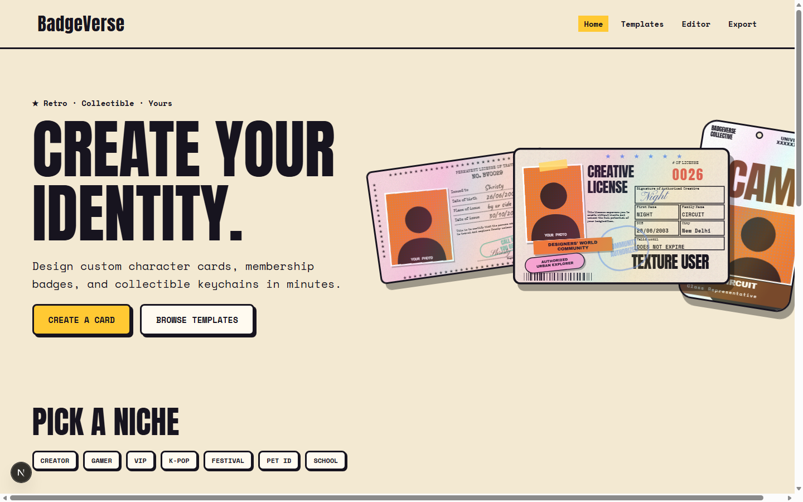
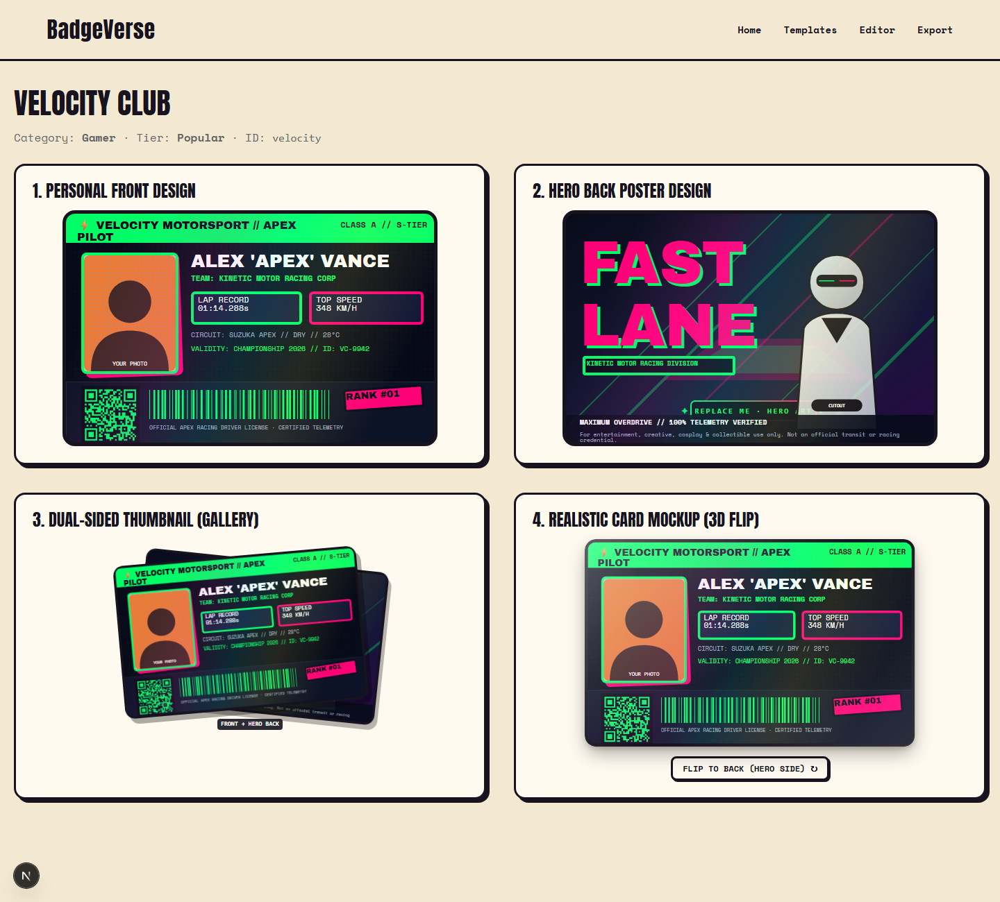
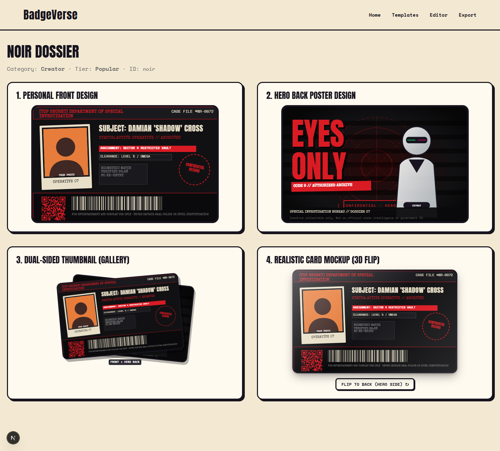
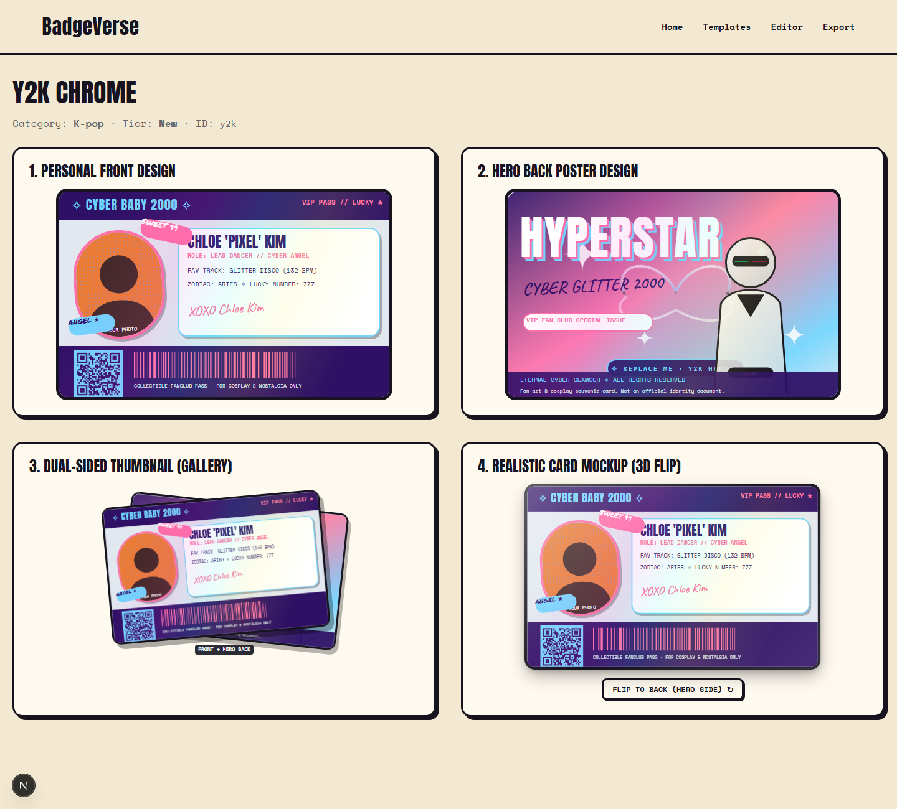
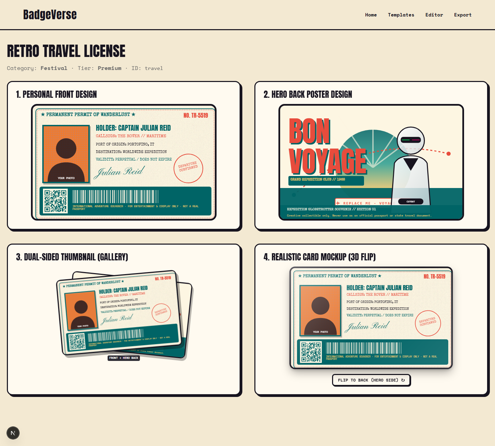

# 🪪 BadgeVerse

> **★ Retro · Collectible · Yours**  
> **Create Your ID.**  
> *Design custom character cards, membership badges, and collectible keychains in minutes.*



BadgeVerse is an interactive web studio for designing custom collectible ID cards, convention badges, cyberpunk licenses, and keychain tags. Powered by Next.js, Framer Motion, and React Konva, it features dual-sided art-directed templates, live 3D card flips, real-time QR/barcode generation, and high-resolution exports.

---

## ⚡ Why BadgeVerse

| Feature | Description |
|---|---|
| **🖐️ Drag-and-drop editor** | Move, resize, layer and rotate every element on the canvas. |
| **📶 Real QR + barcodes** | Generated live from the text you type. |
| **🔄 Front and back** | Design both sides, including an origin story and hero back. |
| **🏷️ Keychain tags** | Same artwork adapted to a tag shape with a hanging hole. |
| **✨ Holo and halftone** | Paper grain, halftone dots, and a holographic sheen. |
| **🖨️ PNG, JPG, PDF** | Export both sides at 3x high-resolution print quality. |

---

## 🎯 How It Works

```text
Step 1: Choose a template  ───►  Step 2: Add photo & details  ───►  Step 3: Tweak colors & stickers  ───►  Step 4: Download or share
```

1. **Step 1 — Choose a template:** Pick from cyberpunk, noir, Y2K, retro travel, transit, arcade, and more.
2. **Step 2 — Add your photo and details:** Name, alias, rank, skills, validity, and scannable codes.
3. **Step 3 — Tweak colors, stickers, layers:** Customize background textures, holographic effects, and badges.
4. **Step 4 — Download or share:** Export in 3x resolution as PNG, JPG, or PDF ready for printing.

---

## 🗂️ Art-Directed Templates (Dual-Sided)

Every template features a bespoke **FRONT** layout (identity, stats, and scannable barcodes) paired with a **HERO BACK** poster layout.

| Velocity Club | Noir Dossier |
| :---: | :---: |
|  |  |
| *Neon telemetry pilot license with high-speed hero back* | *Confidential case file with redacted stamps and vault graphic* |

| Y2K Chrome | Retro Travel License |
| :---: | :---: |
|  |  |
| *Pastel iridescent 2000s cyber aesthetic* | *Vintage passport-style permit with sunburst route poster* |

---

## 💎 Pricing Tiers

- **Free ($0):** Basic templates, PNG export with watermark.
- **Pro ($5/mo):** All templates, no watermark, high-res PDF export.
- **Studio ($15/mo):** Team libraries and bulk generation.

---

## 🛠️ Tech Stack

- **Framework:** [Next.js 15](https://nextjs.org/) (App Router)
- **Language:** [TypeScript](https://www.typescriptlang.org/)
- **Styling:** [Tailwind CSS](https://tailwindcss.com/) with Retro Cream Design System
- **Animation:** [Framer Motion](https://motion.dev/) (with `prefers-reduced-motion` compliance)
- **Canvas Engine:** [React-Konva](https://konvajs.org/) / HTML5 Canvas
- **State Management:** [Zustand](https://github.com/pmndrs/zustand)
- **Document Export:** [jsPDF](https://github.com/parallax/jsPDF) & [html2canvas](https://html2canvas.hertzen.com/)
- **Icons:** [Lucide React](https://lucide.dev/)

---

## 🚀 Getting Started

### Prerequisites

- [Node.js](https://nodejs.org/) (v18.18 or higher)
- [npm](https://www.npmjs.com/) or [pnpm](https://pnpm.io/)

### Local Setup

1. **Clone the repository:**
   ```bash
   git clone https://github.com/Adarshhspeaks/badgeverse.git
   cd badgeverse
   ```

2. **Navigate into the app directory:**
   ```bash
   cd badgeverse
   ```

3. **Install dependencies:**
   ```bash
   npm install
   ```

4. **Run the development server:**
   ```bash
   npm run dev
   ```

5. **Open in your browser:**
   Navigate to [http://localhost:3000](http://localhost:3000).

---

## 📁 Repository Structure

```text
badgeverse/
├── README.md                      # Main documentation & showcase
├── .gitignore                     # Git ignore rules
└── badgeverse/                    # Next.js web application
    ├── src/
    │   ├── app/                   # App Router (/editor, /templates, /preview, /export)
    │   ├── components/
    │   │   ├── cards/             # CardRenderer, CardMockup (3D flip), DualCardThumbnail
    │   │   ├── editor/            # Konva Canvas, LeftPanel, PropsPanel, Toolbar
    │   │   ├── landing/           # Navbar, hero, showcase sections
    │   │   └── ui/                # MotionElements, Toast notifications
    │   ├── lib/                   # Template definitions, types, generators
    │   └── store/                 # Zustand editor state (layers, history, selection)
    ├── public/                    # Assets, placeholder SVGs, and preview screenshots
    └── package.json
```

---

## ⚠️ Disclaimer

> BadgeVerse cards are for **entertainment, creative, collectible, cosplay, gaming, or personal use only**. They are not official identification documents.

---

## 📄 License

Distributed under the MIT License.
